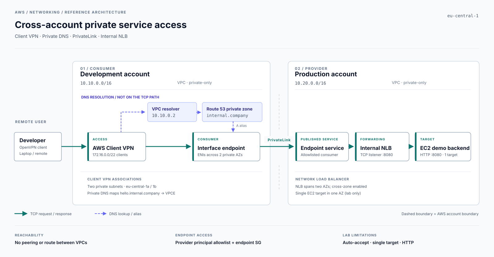

# Cross-account AWS PrivateLink

This OpenTofu lab lets a VPN client reach an HTTP service in another AWS account without VPC peering. The consumer has an interface endpoint and private DNS; the provider serves traffic through an internal Network Load Balancer.



## Quick start

You need two AWS accounts with permissions to create VPC, EC2, NLB, Client VPN, ACM and Route 53 resources. On Linux, install AWS CLI, OpenTofu 1.10.0, OpenSSL and the tools checked by `scripts/00_check_prereqs.sh`. Install OpenVPN to connect after deployment.

Create a **private, versioned S3 state bucket** and a **DynamoDB lock table** (string partition key `LockID`) in each account first. The lab creates billable AWS resources.

From the repository root:

```bash
cp .env.example .env
cp envs/dev/backend.hcl.example envs/dev/backend.hcl
cp envs/prod/backend.hcl.example envs/prod/backend.hcl
# Edit .env and both backend.hcl files for your accounts and state buckets.
set -a
. ./.env
set +a
aws sts get-caller-identity --profile "$DEV_PROFILE"
aws sts get-caller-identity --profile "$PROD_PROFILE"
bash first-run.sh
```

The script creates demo VPN certificates, imports them to ACM in the consumer account, applies the provider stack before the consumer stack, and writes `dev.ovpn`. Both OpenTofu applies ask for approval.

## Connect and verify

Connect with the exported VPN profile:

```bash
sudo openvpn --config dev.ovpn \
  --cert scripts/certs/client.crt \
  --key scripts/certs/client.key \
  --ca scripts/certs/ca.crt
```

In another terminal:

```bash
bash scripts/60_test_privateline.sh
```

The response contains `"message": "Hello from provider"`. If the name does not resolve, configure your VPN client's DNS for `internal.company` to use the consumer VPC resolver at `10.10.0.2`. Do not replace the system-wide resolver configuration.

## Configuration

| Setting | Purpose |
| --- | --- |
| `DEV_PROFILE`, `PROD_PROFILE` in `.env` | AWS CLI profiles for the consumer and provider accounts |
| `AWS_REGION` in `.env` | Region used by both OpenTofu stacks and VPN/ACM commands; defaults to `eu-central-1` |
| `envs/*/backend.hcl` | S3 state bucket, key, bucket region and DynamoDB lock table for each account |
| `envs/*/terraform.tfvars.example` | Example values for manual `tofu apply` commands |

The deployment scripts pass `AWS_REGION` to OpenTofu as `TF_VAR_aws_region`. If you run OpenTofu directly in a different region, set that variable yourself. The two selected availability-zone names use the region's `a` and `b` suffixes.

The example uses consumer `10.10.0.0/16`, provider `10.20.0.0/16`, and TCP port `8080`. These are lab topology values in the root modules.

## Traffic path

Client VPN connects to the consumer VPC. Route 53 resolves `hello.internal.company` to the consumer interface endpoint. PrivateLink carries TCP traffic to the provider's endpoint service, NLB and EC2 target. DNS resolution happens before the TCP connection; the provider VPC is not routed into the consumer VPC.

See [operations](docs/operations.md) for fault checks.

## Local checks

```bash
tofu fmt -check -recursive
tofu -chdir=envs/prod init -backend=false -input=false -lockfile=readonly
tofu -chdir=envs/prod validate
tofu -chdir=envs/dev init -backend=false -input=false -lockfile=readonly
tofu -chdir=envs/dev validate
python3 -m unittest discover -s tests -p 'test_*.py' -v
```

CI uses OpenTofu 1.10.0 and Python 3.12.7. It also runs an offline Client VPN plan test and an IaC scan. The Python tests use AWS CLI mocks and local TCP forwarding; they do not confirm live PrivateLink connectivity or VPN negotiation.

## Teardown

```bash
bash scripts/70_destroy_all.sh
```

The script asks for confirmation and removes consumer resources before provider resources. ACM certificate imports and state backends need separate cleanup.

## Limits

This is a lab, not a deployment template for a live service. It has one EC2 target, plaintext HTTP, no application authentication, automatic acceptance for allowlisted endpoint principals, broad VPC-level VPN authorization, and self-signed demo certificates. It does not provide backend failover.

The code is under the [MIT license](LICENSE).