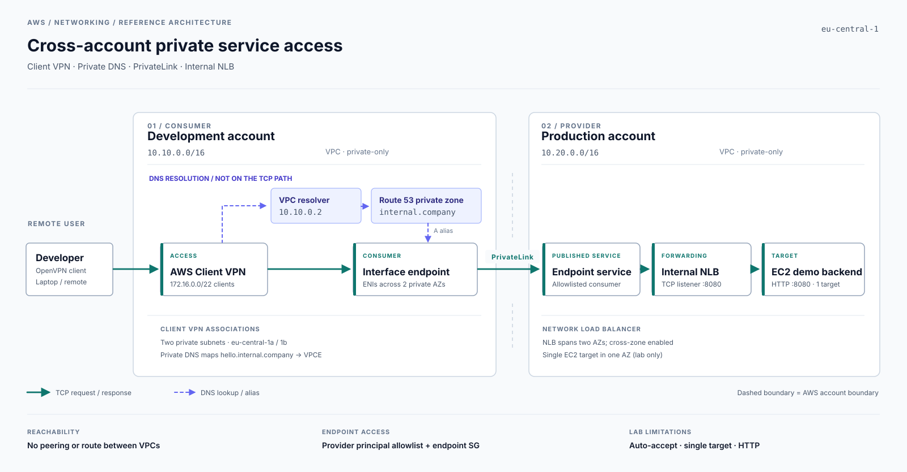

# Network paths

This lab connects a developer's VPN client to one private service in a separate AWS account. The consumer does not read the provider's OpenTofu state or route to its VPC.



The provider publishes an internal NLB as a VPC endpoint service and allows the consumer account to create an endpoint. The consumer creates an interface endpoint and a private Route 53 alias for `hello.internal.company`.

- **DNS:** the VPC resolver at `10.10.0.2` returns the endpoint's private addresses.
- **TCP:** Client VPN -> interface endpoint -> PrivateLink -> internal NLB -> EC2 on port 8080.
- **Access:** the allowed AWS principal permits endpoint creation; security groups and VPN authorization govern network traffic.

The two accounts use separate VPC CIDRs. PrivateLink does not provide routed access to the provider's subnet.

## Run it

Follow the [quick start](../README.md#quick-start) to configure the two state backends and deploy the stacks. Then connect the VPN and run:

```bash
bash scripts/60_test_privateline.sh
```

If DNS fails, check the VPN client's resolver selection before changing Route 53. If TCP times out, check endpoint state and security groups. If the target is unhealthy, check EC2 cloud-init logs and the `hello.service` unit.

More detail is in the [operations guide](operations.md). The example uses one backend, HTTP without TLS, and demo certificates; it is not intended for a real application without further controls.